<h1 align="center">Abd Alrahman Hajjar</h1>

  

  
  
  

I design and evolve backend systems in Python and Java, with a focus on clear module boundaries, documented decisions and systems that stay changeable over the years.

---

### 🧭 What I work on

| Area | Focus |
|---|---|
| **Software architecture** | Modular monoliths, distributed systems, domain-driven design, ADRs |
| **Backend** | Python, Java |
| **APIs & integration** | REST, event-driven communication |
| **Delivery** | Docker, CI/CD pipelines, migration to cloud environments |
| **Engineering practice** | Testing strategies, code reviews, technical documentation |

  <b>Languages</b> 
  
    
  <b>Frameworks, data &amp; tooling</b> 
  

### 🏗️ Selected experience

- **Modularisation** – restructured existing enterprise applications into clearly separated modules and services.
- **Architecture guidelines** – defined guidelines for development teams and anchored them through reviews and mentoring.
- **Cloud migration** – built CI/CD pipelines and planned the move of applications to cloud-based deployments.

### 🎓 Qualifications

- **iSAQB CPSA-F** – Certified Professional for Software Architecture, Foundation Level (September 2026)
- **Fachinformatiker für Anwendungsentwicklung (IHK)** – state-certified IT specialist for software development
- **IHK examiner** – assessing final examinations of trainees in IT professions

### 🔭 Currently focused on

- Quality requirements, architecture evaluation and documentation with the iSAQB methodology
- Domain modelling and the long-term evolution of software systems
- Developer experience and the practical use of AI tools in engineering workflows

### 🤝 Beyond work

Teaching IT skills as a volunteer in community projects since 2023.

---

### 📊 GitHub activity

  <picture>
    <source media="(prefers-color-scheme: dark)" srcset="https://raw.githubusercontent.com/AbdHajjar/AbdHajjar/output/stats-dark.svg">
    
  </picture>
  <picture>
    <source media="(prefers-color-scheme: dark)" srcset="https://raw.githubusercontent.com/AbdHajjar/AbdHajjar/output/top-langs-dark.svg">
    
  </picture>

  <picture>
    <source media="(prefers-color-scheme: dark)" srcset="https://raw.githubusercontent.com/AbdHajjar/AbdHajjar/output/snake-dark.svg">
    
  </picture>

